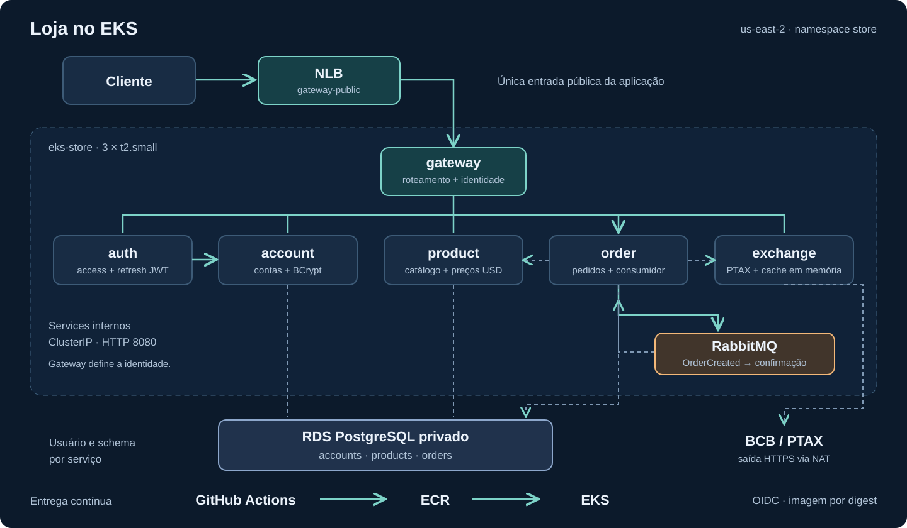

# Arquitetura e contratos

A loja separa autenticação, contas, catálogo, pedidos e cotações em serviços independentes. O gateway é a entrada da aplicação; chamadas internas usam os Services do Kubernetes no namespace `store`.



## Caminho de uma requisição

1. O cliente chega ao NLB, que encaminha ao gateway.
2. Em uma rota protegida, o gateway envia o token ao auth em `POST /auth/solve`.
3. O gateway remove qualquer `id-account` fornecido pelo cliente e insere a identidade resolvida.
4. O serviço de destino aplica suas regras de negócio e propriedade dos dados.

Cadastro, login, logout e refresh são abertos no gateway. `/auth/solve` e `/accounts/login` são internos e recebem 404 quando acessados por ele. As demais rotas de conta exigem token e só permitem ler ou excluir a conta autenticada. O auth usa o account por HTTP; não lê diretamente suas tabelas.

| Origem | Destino interno | Contrato |
|---|---|---|
| gateway | `auth:8080` | Resolve o token e obtém `idAccount` |
| gateway | account, product, order e exchange na porta 8080 | Encaminha a chamada com `id-account` confiável |
| auth | `account:8080/accounts` e `/accounts/login` | Cadastro e verificação de credenciais |
| order | `product:8080/products/{id}` | Obtém o preço em USD antes de persistir |
| order | `exchange:8080/exchanges/USD/{currency}` | Obtém a cotação de venda para converter a resposta |
| relay de order | RabbitMQ, exchange `store.orders`, chave `created` | Publica o evento `OrderCreated` |
| consumidor de order | Fila `orders.created` | Registra a confirmação e confirma a mensagem após o commit |

## Dados e isolamento

Account, product e order usam o mesmo RDS PostgreSQL privado, com um usuário e schema por serviço: `accounts`, `products` e `orders`. Flyway mantém as tabelas. Auth não tem banco; exchange consulta a PTAX e mantém cotações em memória. A identidade da conta não entra no cache compartilhado de cotações.

O produto guarda preços positivos em USD com duas casas decimais. O pedido consulta esses preços e conserva uma cópia deles. Um total enviado pelo cliente não é considerado. A leitura de pedido filtra simultaneamente o identificador do pedido e a conta, retornando 404 para outro dono.

```json
{"items":[{"idProduct":"UUID_DO_PRODUTO","quantity":2}]}
```

A consulta `GET /orders/{id}?currency=BRL` usa `sell` do exchange e não modifica o pedido em USD. Produto inexistente gera 400 ao criar pedido; moeda sem cobertura gera 422; falha de dependência gera 503.

## Assíncrono e síncrono

Preço e câmbio são dependências HTTP. A confirmação do pedido é assíncrona: pedido e evento entram na mesma transação, o relay publica com confirmação do broker e o consumidor deduplica pelo `eventId`. Mensagens inválidas e falhas após as tentativas vão à DLQ. Veja as [garantias e limites da mensageria](mensageria.md), inclusive o armazenamento temporário do RabbitMQ.

## Contratos completos

As páginas de [gateway](services/gateway.md), [auth](services/auth.md), [account](services/account.md), [product](services/product.md), [order](services/order.md) e [exchange](services/exchange.md) detalham endpoints, health-checks e execução. A [infraestrutura](deployment.md) e o [CI/CD](ci-cd.md) completam o caminho de operação.
