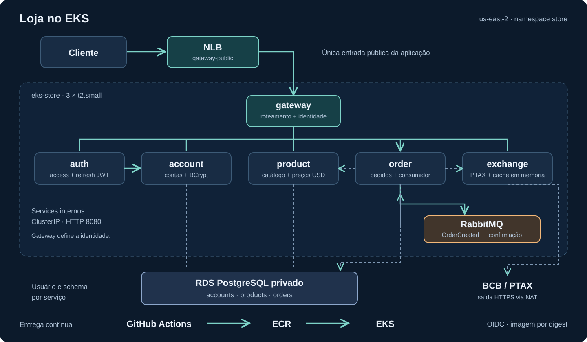

# Loja em microsserviços

Seis serviços independentes compõem a loja: gateway, auth, account, product, order e exchange. A aplicação roda no Amazon EKS; o gateway recebe o tráfego do NLB, o RDS guarda os dados de negócio e o RabbitMQ desacopla a confirmação dos pedidos.

Esta documentação reúne a arquitetura, os contratos HTTP, a operação e as evidências da entrega. A referência de infraestrutura é o estado de **19/11/2026**, descrito em [AWS e EKS](deployment.md). As medições mantêm suas próprias datas e ambientes.

## Navegar pela entrega

| Item da entrega | Onde conferir |
|---|---|
| Arquitetura e comunicação entre serviços | [Arquitetura e contratos](architecture.md) |
| Função, endpoints e execução de cada serviço | [Gateway](services/gateway.md), [auth](services/auth.md), [account](services/account.md), [product](services/product.md), [order](services/order.md) e [exchange](services/exchange.md) |
| Health-checks dos seis serviços | [Tabela de operação](deployment.md#health-checks-e-probes) e página de cada serviço |
| Kubernetes e infraestrutura AWS | [AWS e EKS](deployment.md) |
| Testes, imagens e implantação | [CI/CD com GitHub Actions, ECR e OIDC](ci-cd.md) |
| Gargalo escolhido e evidências | [Mensageria e EDA](mensageria.md) |
| Carga em Spring Boot e escalonamento | [Teste de carga e HPA](load-testing.md) |
| Serviços gerenciados, plano de gastos e disponibilidade | [Custos, PaaS e SLA](costs.md) |
| Roteiro, slides e vídeo | [Apresentação](presentation.md) |
| Responsabilidades e uso de IA | [Equipe e autoria](team.md) |
| Reprodução local e resultados históricos | [Desenvolvimento local](development.md) e [validação](validation.md) |

## Fluxo demonstrado

O cliente se cadastra e faz login pelo gateway, cria um produto e envia um pedido. O order consulta o preço no product, grava o pedido e o evento na mesma transação e devolve 201. Um relay publica o evento no RabbitMQ; o consumidor confirma o pedido depois, com deduplicação e DLQ. A conversão de uma consulta de pedido usa o exchange sem alterar os valores persistidos em USD.

A apresentação terá de um a dois minutos. O [roteiro e os slides](presentation.md) estão preparados; a gravação, a edição e a inclusão do link final pertencem ao DOC-04.

## Repositórios independentes

Cada serviço tem seu próprio README, build, Dockerfile, manifests e workflow. O agregador fixa versões por submodules e publica o MkDocs no GitHub Pages. Os workflows de cada serviço são a referência de deploy no EKS; os scripts Python do agregador são ferramentas de preparação e laboratório.
