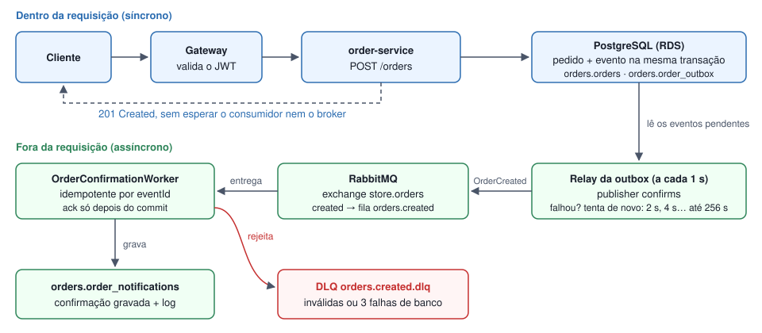

# Mensageria (EDA)

Escolhemos o gargalo de **mensageria**. O enunciado o define como *"Decoupling components to handle asynchronous tasks. Use message queues like RabbitMQ or Apache Kafka."*

Desacoplamos a **confirmação do pedido** do `POST /orders`. Ela é o "e-mail" de confirmação; como o projeto não tem servidor de e-mail, uma linha de log faz esse papel. Se ela rodasse dentro da requisição, o tempo do envio entraria na latência de cada pedido, e uma falha do envio derrubaria a criação do pedido. Com a fila, o pedido responde assim que fica gravado, e a confirmação sai depois, num consumidor.



## Como funciona

1. **Outbox transacional.** O `POST /orders` grava o pedido e o evento `OrderCreated` na **mesma transação** (`orders.orders` e `orders.order_outbox`) e responde 201 sem falar com o broker. Assim, um pedido gravado sempre tem o seu evento, e um evento nunca existe sem o pedido.
2. **Relay.** A cada 1 s (`OUTBOX_POLL_DELAY`), o order-service lê até 20 eventos pendentes e os publica no exchange `store.orders`, com routing key `created`, usando *publisher confirms*. Se o broker não confirma, o evento volta para a outbox e é tentado de novo com backoff exponencial: 2 s, 4 s, 8 s… até 256 s.
3. **Fila.** A fila durável `orders.created` entrega os eventos ao `OrderConfirmationWorker`. Ele é um `@RabbitListener` dentro do próprio order-service, ligado por `ORDER_WORKER_ENABLED=true`. Isso não exige imagem, repositório nem pipeline novos, e não gasta memória a mais nos nós.
4. **Consumidor.** O worker grava a confirmação em `orders.order_notifications` e registra o envio no log. O ack só acontece depois do commit.
5. **Erros.** Uma mensagem inválida vai direto para a DLQ `orders.created.dlq`. Uma falha de banco tem 3 tentativas e, depois, também vai para a DLQ. Nenhuma mensagem fica em loop de reentrega.

O evento publicado:

| Campo | Exemplo |
|---|---|
| `eventId` | UUID único do evento; é a chave da idempotência |
| `type` | `OrderCreated` |
| `orderId`, `accountId` | o pedido e a conta que o criou |
| `createdAt` | `2026-11-18T19:29:58.515454Z` |
| `currency`, `total` | `USD`, `20.24` (os valores são guardados em USD) |

## Garantias

| Situação | O que acontece |
|---|---|
| Broker fora do ar | Os pedidos continuam com 201. Os eventos esperam na outbox e são entregues quando o broker volta. O readiness do order não depende do RabbitMQ, então o pod continua recebendo tráfego |
| Mesma mensagem entregue duas vezes (*at-least-once*) | O `eventId` é a chave primária de `order_notifications`. A repetição é confirmada (ack) sem efeito e contada como `duplicate` |
| Mensagem inválida | Vai direto para a DLQ, sem reentrega, e é contada como `rejected` |
| Banco fora do ar no consumidor | São 3 tentativas com espera crescente; depois, a mensagem vai para a DLQ, de onde pode ser reprocessada |
| Consumidor lento | A fila acumula e o `POST /orders` continua com a mesma latência |
| Pod do RabbitMQ reiniciado | **Limite aceito:** o broker usa `emptyDir`, então as mensagens já publicadas e ainda não consumidas se perdem. Com o consumidor rodando, a fila fica perto de zero. Para ter durabilidade, seria preciso o driver EBS (CSI) e um PVC |

## No cluster

- **RabbitMQ 4.2:** StatefulSet de 1 réplica no namespace `store`, com Service `ClusterIP` (sem porta pública), requests de 100m e 256 MiB e limite de 512 MiB. A imagem é fixada por digest, e as credenciais ficam só no Secret `rabbitmq-secrets`.
- **order-service:** `MESSAGING_ENABLED=true` e `ORDER_WORKER_ENABLED=true`, desde o deploy de 17/11.
- O exchange-service também sabe publicar `QuoteFetched`, mas isso é só telemetria e fica desligado no EKS. Perder uma cotação não tem efeito no negócio.
- **Por que RabbitMQ:**
    - o order já publicava em AMQP com outbox e DLQ;
    - Kafka exigiria reescrever os produtores e pediria mais memória do que os nós t2.small têm;
    - o Amazon MQ custaria mais do que o RabbitMQ dentro do cluster.

## Evidências (18/11/2026, no EKS)

**Ponta a ponta.** O `scripts/e2e-gateway.sh` (66 verificações pelo gateway) cria um pedido. O worker o confirma ~1 s depois:

```text
OrderConfirmationWorker : Order dea1e1a5-… confirmed: confirmation sent to account b925575f-… (total 20.24 USD)
```

**O POST não espera o consumidor.** Foram 10 pedidos seguidos, pelo NLB, de fora da AWS:

| Medida | Valor |
|---|---|
| Latência do `POST /orders` | mediana de 370 ms (de 313 a 426 ms) |
| Pedidos confirmados pelo consumidor | 10 de 10 |
| Tempo da gravação do pedido até a confirmação | mediana de 0,53 s, máximo de 1,09 s (o relay lê a outbox a cada 1 s) |

**Mensagem envenenada.** Um payload que não é JSON, publicado à mão em `store.orders`/`created`, foi rejeitado e ficou na DLQ. A fila principal ficou vazia:

```text
OrderConfirmationWorker : Rejecting an invalid order event (message id poison-demo-bot05) to the DLQ

name                 messages  consumers
orders.created.dlq   1         0
orders.created       0         1
```

**Métricas** (Prometheus, em `order-metrics:9091/actuator/prometheus`):

```text
orders_outbox_deliveries_total{result="published"} 12.0
orders_events_consumed_total{result="processed"}   12.0
orders_events_consumed_total{result="rejected"}    1.0
rabbitmq_failed_to_publish_total                   0.0
```

**Broker fora do ar e consumidor lento.** Essas duas demonstrações alteram o cluster, então rodam pelo `scripts/demo-eda.sh` e aparecem no vídeo da apresentação. O script:

- escala o RabbitMQ a 0, cria pedidos (todos respondem 201), religa o broker e mostra a outbox drenando, com cada pedido confirmado uma vez só;
- liga o `ORDER_WORKER_DELAY=3s` e mostra que o `POST /orders` mantém a latência enquanto as confirmações saem a cada 3 s.

No fim, ele volta tudo ao normal.

## Como conferir

```bash
# filas e consumidores
kubectl -n store exec rabbitmq-0 -- rabbitmqctl list_queues name messages consumers

# métricas de entrega e de consumo
kubectl get --raw "/api/v1/namespaces/store/services/order-metrics:management/proxy/actuator/prometheus" \
  | grep -E '^orders_(outbox_deliveries|events_consumed)_total'

# confirmações no log
kubectl -n store logs deploy/order | grep 'confirmed: confirmation sent'

# as quatro demonstrações; MUDA O CLUSTER e volta ao normal no fim (~7 min)
scripts/demo-eda.sh http://<DNS do NLB>
```

## Limites e próximos passos

- **Durabilidade:** com `emptyDir`, um restart do broker perde as mensagens em trânsito. O próximo passo é instalar o add-on `aws-ebs-csi-driver` e trocar por um PVC de 1 GiB (cerca de US$ 0,10 por mês).
- **Alta disponibilidade:** o broker tem 1 réplica. Um cluster de 3 nós com *quorum queues* evitaria o ponto único de falha, mas não cabe nos t2.small atuais.
- **Escala do consumidor:** o worker roda no mesmo pod do order. Se o volume crescer, a mesma imagem pode subir num Deployment `order-worker` separado, com só o listener ligado.

---

*Autoria: o produtor (outbox e relay) foi implementado pelo colega `adventurescumm`, até 16/11. Em 17/11, o agente do João (Claude) implementou, com autorização dele, o consumidor, o RabbitMQ no cluster e a ligação no EKS (BOT-02 a BOT-04); a declaração está no README do order-service. Esta página foi escrita com auxílio de IA, como o enunciado permite para a documentação.*
